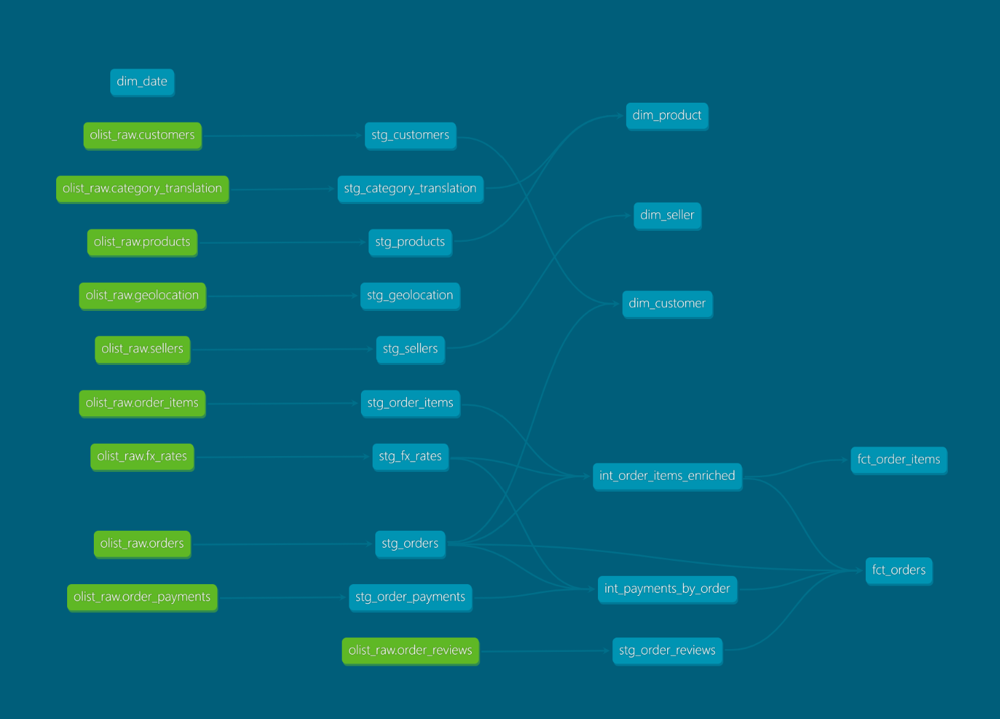
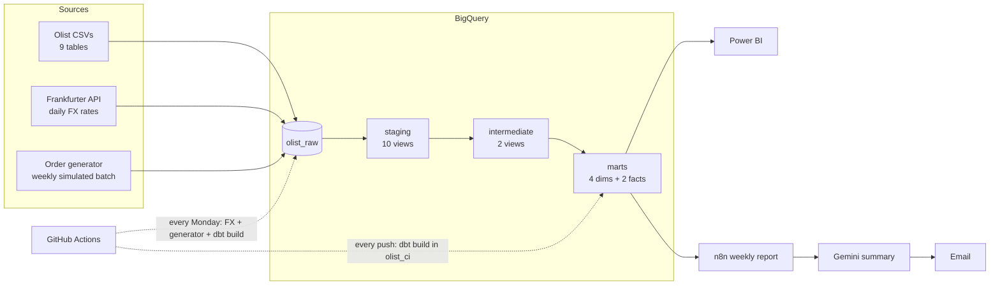
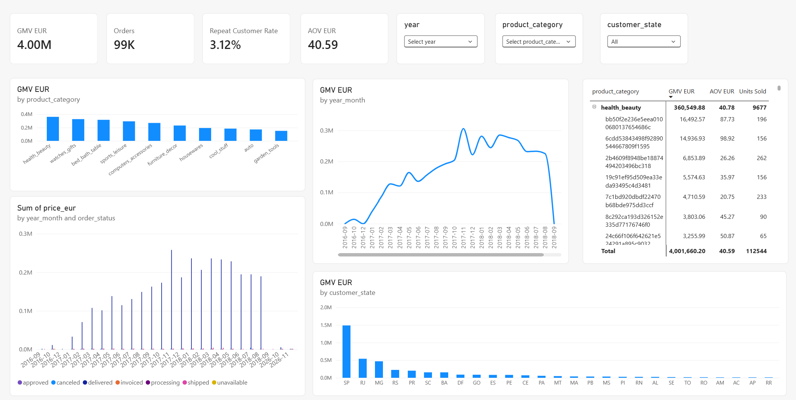
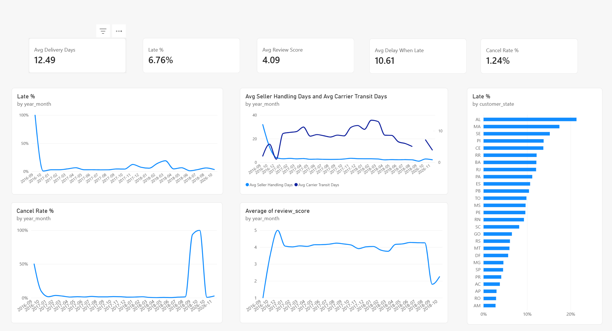
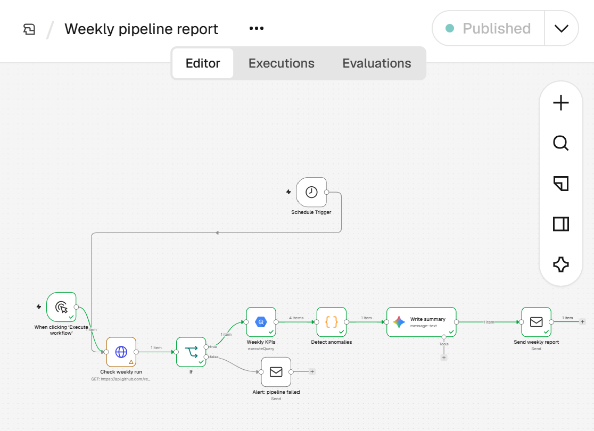

# Olist Analytics Platform

An end-to-end analytics pipeline on the public [Olist](https://www.kaggle.com/datasets/olistbr/brazilian-ecommerce) Brazilian e-commerce dataset (~100k orders): ingestion, dbt modelling and testing in BigQuery, Power BI dashboards, scheduled runs with GitHub Actions, and a weekly monitoring report written by an LLM and delivered by n8n.

Revenue is reported in **EUR** using daily BRL→EUR exchange rates pulled from an API. Because the Olist data stops in 2018, a generator adds a small batch of **simulated orders every week** (clearly flagged with `is_simulated`), so the pipeline, the incremental models and the monitoring all run on live data.



---

## Architecture



| Layer | Tool | What it does |
|---|---|---|
| Ingestion | Python | `scripts/load_fx_rates.py` (incremental API load), `scripts/generate_orders.py` (weekly simulated orders) |
| Warehouse | BigQuery (EU) | `olist_raw` (sources), `olist_dev` (models), `olist_ci` (CI builds) |
| Transformation | dbt 1.12 | staging → intermediate → star schema, 20 data tests |
| BI | Power BI | Revenue overview, delivery and cancellation monitoring, weekly monitoring |
| Orchestration | GitHub Actions | CI on every push; weekly pipeline every Monday 07:00 Paris |
| Alerting | n8n + Gemini | Checks the weekly run, applies anomaly rules, writes and emails a report |

---

## Data model

```
models/
├── staging/        one model per source table, cleaning only (10 views)
├── intermediate/   joins, EUR conversion, grain changes (2 views)
└── marts/          star schema for BI (tables)
    ├── dim_customer, dim_product, dim_seller, dim_date
    ├── fct_orders        one row per order
    └── fct_order_items   one row per item (incremental)
```

Key modelling decisions:

- **EUR conversion at purchase date.** Rates come only on business days; `stg_fx_rates` builds a daily calendar and forward-fills weekends with `last_value(... ignore nulls)`, flagged by `is_filled`.
- **No fan-out.** Payments (several per order) and reviews are aggregated to order grain *before* joining to orders. Row counts are checked against the source after every join, and both fact tables reconcile to the cent (€4,019,829.62 of historical GMV).
- **Customer identity.** Olist creates a new `customer_id` for every order. Counting real people requires `customer_unique_id`; doing so shows that only **~3% of customers ever reorder**.
- **Incremental fact table.** `fct_order_items` merges on a surrogate key with a 3-day lookback window, so late-arriving updates overwrite rather than duplicate.
- **Delivery split into stages.** `fct_orders` separates seller handling time from carrier transit time, so a late-delivery alert also points to where the delay happened.
- **Raw data stays raw.** Source issues are fixed upstream (e.g. a translation table whose header was misread was reloaded with an explicit schema) rather than patched in models.

---

## Testing and CI

- 20 dbt tests: primary keys (`unique`, `not_null`), every fact foreign key against its dimension (`relationships`), and order status values (`accepted_values`).
- **CI** (`.github/workflows/ci.yml`): every push builds and tests all models in a separate `olist_ci` dataset, so a broken change never touches the tables Power BI reads.
- **Weekly pipeline** (`.github/workflows/weekly.yml`): loads new FX rates, generates last week's simulated orders, then runs `dbt build` on the production dataset.
- Authentication uses dedicated service accounts with least privilege (read/write for GitHub Actions, read-only for n8n). Keys live only in GitHub Secrets and n8n's encrypted credentials.

---

## Simulated weekly orders

`scripts/generate_orders.py` keeps the pipeline "live" without inventing unrealistic data:

- It **resamples real orders** and shifts all their timestamps into last week, so status mix, delivery durations, prices and payment methods follow the real distribution, and every foreign key exists in the dimensions.
- Each order is stored with its **full planned timeline**. `stg_orders` hides events that have not happened yet (`current_timestamp()`), so orders move from *shipped* to *delivered* on their own over time.
- About 30% of weeks get an **injected anomaly** (slower carriers, slower sellers, or a cancellation spike), recorded in `olist_raw.sim_batches`. This is the ground truth used to check that the monitoring actually catches problems.
- Simulated rows carry `is_simulated = true` and are excluded from historical analysis and from the repeat-customer calculation.

---

## Dashboards




Findings from the historical data:

- **GMV of €4.02M** over two years; São Paulo state alone is several times larger than any other state.
- **Carrier transit is ~75% of delivery time** (9.3 of 12.5 days on average); seller handling is stable at around 3 days.
- **6.8% of delivered orders arrive late**, concentrated in northern and north-eastern states.
- **~3% repeat customers**: growth on the platform is driven almost entirely by acquisition.

---

## Weekly monitoring report (n8n)



Every Monday at 08:00, after the GitHub run:

1. **Check the pipeline.** Calls the GitHub API; if the latest weekly run failed or did not happen in the last two days, sends an alert with a link to the run.
2. **Query weekly KPIs** for simulated orders: volume, cancellation rate, delivered share, late rate, seller and carrier days, GMV.
3. **Apply anomaly rules** in code. Volume and cancellations are judged on the latest week. Delivery metrics are only judged on the latest **final** week (≥80% of orders delivered), because recent weeks look artificially good while slow parcels are still in transit.
4. **Gemini writes the summary**, and the rule-based alerts are appended verbatim below it.

Design choice: **rules decide, the LLM only writes.** During testing, the model attributed a cancellation spike to "seller handling" with no basis in the data. The prompt was tightened, and the alerts themselves never depend on the model's wording.

The exported workflow is in `n8n/weekly_pipeline_report.json` (credentials are not included).

---

## Repository structure

```
.
├── .github/workflows/   ci.yml, weekly.yml
├── scripts/             load_fx_rates.py, generate_orders.py
├── olist/               dbt project (models, tests, ci/profiles.yml)
├── n8n/                 exported n8n workflow
├── dashboard/           Power BI file (not versioned)
└── docs/images/         screenshots used in this README
```

---

## Running it

```bash
pip install -r requirements.txt
gcloud auth application-default login

python scripts/load_fx_rates.py
python scripts/generate_orders.py --weeks 4 --scenario normal

cd olist
dbt build
```

A dbt profile named `olist` pointing to your own BigQuery project is required (see `olist/ci/profiles.yml` for the shape).

---

## Limitations and next steps

- n8n runs locally, so the Monday report only fires when the machine is on. In production it would run on a server or n8n Cloud.
- `stg_geolocation` is cleaned but not yet used; ZIP code prefixes lost their leading zeros at load time and would need padding before mapping.
- A seller SLA check (actual handover vs `shipping_limit_date`) would make seller monitoring more precise than average handling days.
- Simulated orders reuse real customer IDs; a fuller simulation would also generate new customers.
# Olist Analytics Platform
